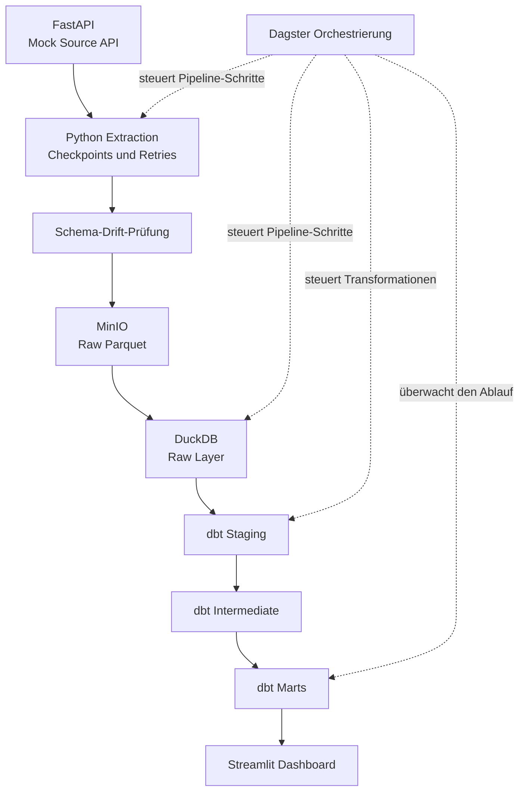

# Technische Architektur – E-Commerce ELT Pipeline

## 1. Überblick

Die E-Commerce ELT Pipeline verarbeitet Bestelldaten aus einer simulierten REST-API und überführt sie in analytisch nutzbare Datenmodelle.

Die Architektur trennt die einzelnen Verarbeitungsschritte in eigenständige Komponenten:

- **Quelle:** FastAPI stellt simulierte Bestelldaten bereit.
- **Extraktion:** Python ruft die Daten ab und verwaltet den Fortschritt der Extraktion.
- **Objektspeicher:** MinIO speichert die Rohdaten als Parquet-Dateien.
- **Data Warehouse:** DuckDB stellt die analytische Datenbank bereit.
- **Transformation:** dbt modelliert die Daten in mehreren Schichten.
- **Orchestrierung:** Dagster steuert den Ablauf der Pipeline.
- **Visualisierung:** Streamlit präsentiert ausgewählte Analyseergebnisse.
- **Qualitätssicherung:** Python-Unit-Tests, dbt-Tests und GitHub Actions unterstützen die Überprüfung der Implementierung.

## 2. Architekturdiagramm

Dagster bildet die Orchestrierungsschicht. Das Diagramm zeigt den fachlichen Datenfluss; die genaue technische Abhängigkeit zwischen den einzelnen Dagster-Assets und -Ops richtet sich nach der Implementierung in `definitions.py`.

## 3. Komponenten

### 3.1 Mock Source API

**Verzeichnis:** `mock_source_api/`

Die FastAPI-Anwendung simuliert eine externe E-Commerce-Quelle und stellt Bestelldaten über eine REST-Schnittstelle bereit.

Wichtige Aufgaben:

- Bereitstellung der Bestelldaten
- Simulation typischer API-Bedingungen wie Rate Limits und vorübergehenden Fehlern, soweit in der Konfiguration aktiviert
- Bereitstellung eines Health-Endpunkts
- Ausführung als separater Docker-Service

Die simulierte Quelle ermöglicht es, Extraktions- und Fehlerbehandlung zu testen, ohne von einer externen Produktiv-API abhängig zu sein.

### 3.2 Datenextraktion

**Verzeichnis:** `extract/`

Die Python-Komponenten übernehmen den Abruf der Quelldaten und bereiten sie für die weitere Verarbeitung vor.

| Datei | Aufgabe |
|---|---|
| `extract_orders.py` | Abruf und Verarbeitung der Bestelldaten |
| `checkpoint_store.py` | Speicherung und Verwaltung des Extraktionsfortschritts |
| `schema_drift_check.py` | Erkennung relevanter Veränderungen im Datenbankschema der Quelle |

Checkpoints ermöglichen es, den Fortschritt der Extraktion festzuhalten. Wiederholungsversuche helfen dabei, vorübergehende API-Fehler und Rate Limits zu behandeln.

Die Schema-Prüfung unterstützt die Erkennung von Änderungen an der erwarteten Datenstruktur. Ob eine erkannte Änderung zum Abbruch führt oder anders behandelt wird, hängt von der konkreten Implementierung und Konfiguration ab.

### 3.3 Rohdatenspeicherung in MinIO

**Verzeichnis:** `staging_minio/`

Die extrahierten Daten werden als Parquet-Dateien im Objektspeicher abgelegt.

`upload_to_minio.py` übernimmt den Upload der Rohdaten nach MinIO.

Die Trennung von Extraktion und analytischer Verarbeitung bietet mehrere Vorteile:

- Rohdaten können für erneute Verarbeitungsschritte erhalten bleiben.
- Objektspeicherung und Data Warehouse sind voneinander getrennt.
- Das spaltenorientierte Parquet-Format eignet sich für analytische Datenverarbeitung.

### 3.4 DuckDB Data Warehouse

**Verzeichnis:** `warehouse/`

DuckDB dient als analytische Datenbank für die lokal ausgeführte Pipeline.

| Datei | Aufgabe |
|---|---|
| `init.sql` | SQL-Initialisierung für die Warehouse-Struktur |
| `load_orders.py` | Laden der Rohdaten in das Warehouse |

Die Rohdaten werden in der Raw-Schicht bereitgestellt. Darauf aufbauend erstellen die dbt-Modelle bereinigte, angereicherte und aggregierte Datensätze.

Die konkrete Verbindung zwischen MinIO, Parquet und DuckDB wird durch die Loader- und Warehouse-Konfiguration bestimmt.

### 3.5 Transformationen mit dbt

**Verzeichnis:** `dbt_project/`

Die SQL-Transformationen sind in drei logische Schichten gegliedert.

#### Staging

**Modell:** `stg_orders.sql`

Die Staging-Schicht vereinheitlicht die Rohdaten und bereitet sie für die weitere Verarbeitung auf. Dazu gehören die Normalisierung von Feldern und die Behandlung von Duplikaten entsprechend der Modelllogik.

#### Intermediate

**Modell:** `int_orders_with_delay_flags.sql`

Die Intermediate-Schicht ergänzt die Bestellungen um Merkmale zur Lieferverzögerung. Die Analyse berücksichtigt den Lieferstatus, damit nicht abgeschlossene Lieferungen nicht wie bereits abgeschlossene Lieferungen ausgewertet werden.

#### Marts

**Modell:** `mart_delivery_performance.sql`

Die Mart-Schicht stellt aggregierte Kennzahlen zur Lieferperformance für analytische Auswertungen bereit.

#### Datenqualitätstests

Die YAML-Dateien der Modelle definieren unter anderem Spaltenbeschreibungen und Datentests. Der SQL-Test `assert_no_future_orders.sql` prüft, ob Bestellungen mit Zeitstempeln in der Zukunft vorhanden sind.

Die Tests decken unter anderem folgende Aspekte ab:

- Pflichtfelder sind nicht leer.
- Bestell-IDs sind eindeutig.
- Statuswerte gehören zu den erlaubten Werten.
- Bewertungswerte liegen im vorgesehenen Wertebereich.
- Bestelldaten liegen nicht in der Zukunft.

### 3.6 Orchestrierung mit Dagster

**Verzeichnis:** `orchestration/dagster_pipeline/`

Dagster koordiniert die Verarbeitungsschritte der Pipeline.

| Datei | Aufgabe |
|---|---|
| `definitions.py` | Definition der Dagster-Pipeline und ihrer ausführbaren Komponenten |
| `alerts.py` | Benachrichtigungs- oder Alarmierungslogik, entsprechend der implementierten Funktionen |

Der zentrale Workflow heißt `full_elt_pipeline`.

Dagster ermöglicht es, Pipeline-Läufe über die Benutzeroberfläche zu starten und deren Status sowie Laufprotokolle einzusehen. Dadurch lassen sich Fehler in einzelnen Verarbeitungsschritten leichter lokalisieren.

### 3.7 Dashboard mit Streamlit

**Verzeichnis:** `dashboard/`

`app.py` stellt die Ergebnisse der Datenverarbeitung in einer interaktiven Oberfläche dar.

Der Schwerpunkt liegt auf Kennzahlen zur Lieferperformance. Das Dashboard bildet die Präsentationsschicht und ersetzt weder die Datenbank noch die Transformationslogik.

### 3.8 Tests und Continuous Integration

**Verzeichnisse:** `tests/` und `.github/workflows/`

Die Unit-Tests prüfen ausgewählte Python-Funktionen. Die dbt-Tests überprüfen Eigenschaften der transformierten Daten.

Der Workflow `ci.yml` definiert die automatisierten Prüfungen, die GitHub Actions bei den konfigurierten Ereignissen ausführt.

Welche Services in CI tatsächlich gestartet werden und welche Tests dort laufen, ergibt sich aus der konkreten Workflow-Konfiguration.

## 4. Datenfluss

Der fachliche Ablauf besteht aus den folgenden Schritten:

1. Die Mock Source API stellt Bestelldaten bereit.
2. Die Extraktionskomponente ruft die Daten ab und verwaltet den Fortschritt über Checkpoints.
3. Die extrahierten Daten werden als Parquet-Dateien in MinIO gespeichert.
4. Der Loader übernimmt die Rohdaten in DuckDB.
5. dbt erstellt das Staging-Modell.
6. Das Intermediate-Modell ergänzt die Daten um Lieferverzögerungsmerkmale.
7. Das Mart-Modell aggregiert die Kennzahlen zur Lieferperformance.
8. Dagster koordiniert die Verarbeitungsschritte.
9. Streamlit visualisiert die bereitgestellten Analyseergebnisse.

Die Reihenfolge beschreibt den logischen Ablauf. Die tatsächliche Ausführung und die Abhängigkeiten werden von der Dagster-Konfiguration bestimmt.

## 5. Fehlerbehandlung und Zuverlässigkeit

Die Pipeline berücksichtigt mehrere typische Herausforderungen bei Datenverarbeitung:

- **Vorübergehende API-Fehler:** Wiederholungsversuche können temporäre Fehler abfangen.
- **Rate Limits:** Die Extraktion kann auf begrenzte API-Anfrageraten reagieren.
- **Fortschrittsspeicherung:** Checkpoints halten den Extraktionsfortschritt fest.
- **Schemaänderungen:** Die Schema-Prüfung hilft, unerwartete Änderungen an Quelldaten zu erkennen.
- **Datenqualität:** dbt-Tests prüfen zentrale Annahmen über die Daten.
- **Nachvollziehbarkeit:** Dagster stellt Informationen zu Pipeline-Läufen und deren Status bereit.

Diese Mechanismen verbessern die Nachvollziehbarkeit und Robustheit. Sie stellen für sich genommen keine Garantie für vollständige Fehlerfreiheit oder Produktionsreife dar.

## 6. Validierung

In der lokalen Entwicklungsumgebung wurde der Workflow erfolgreich ausgeführt.

Die dokumentierten Prüfergebnisse umfassen:

- erfolgreichen Dagster-Lauf von `full_elt_pipeline`
- neun erfolgreiche dbt-Datentests
- 500 Bestellungen in der Raw- und Staging-Schicht
- 500 eindeutige Bestell-IDs in beiden Schichten
- Übereinstimmung ausgewählter Kennzahlen zwischen Intermediate-Modell und Mart

Die Ergebnisse beziehen sich auf den verwendeten Testdatenbestand und die lokale Konfiguration.

## 7. Bewusste Architekturentscheidungen

### Lokaler analytischer Stack

DuckDB ermöglicht analytische SQL-Abfragen ohne einen separaten, dauerhaft betriebenen Datenbankserver. Zusammen mit MinIO, Docker Compose und Dagster lässt sich der Workflow lokal nachvollziehbar ausführen.

### Trennung von Speicherung und Transformation

MinIO übernimmt die Speicherung der Rohdateien, während DuckDB und dbt für die analytische Verarbeitung zuständig sind. Dadurch werden Rohdatenspeicherung und Datenmodellierung logisch voneinander getrennt.

### Schichtenmodell mit dbt

Die Trennung in Staging, Intermediate und Marts macht Transformationen nachvollziehbarer und erleichtert die Wartung und Erweiterung der Datenmodelle.

### Orchestrierung statt manueller Einzelschritte

Dagster bündelt die Pipeline-Schritte in einem ausführbaren Workflow und stellt Informationen zu den einzelnen Läufen bereit.

## 8. Grenzen und mögliche Erweiterungen

Das Projekt ist auf eine lokal ausführbare Portfolio-Umgebung ausgelegt. Mögliche zukünftige Erweiterungen wären:

- Ausführung auf einer Cloud-Infrastruktur
- zentrale Verwaltung von Secrets
- umfassendere Monitoring- und Alarmierungsmechanismen
- zusätzliche Integrations- und Wiederanlauftests
- Dokumentation und Validierung des vollständigen Setups auf einer frischen Umgebung
- Erweiterung der Datenmodelle um weitere Geschäftskennzahlen