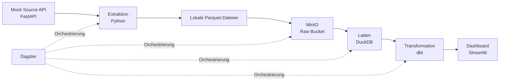

# E-Commerce ELT Pipeline

Ein End-to-End-Data-Engineering-Projekt, das Bestelldaten über eine simulierte REST-API extrahiert, als Parquet-Dateien in MinIO speichert, in DuckDB lädt, mit dbt transformiert und den gesamten Ablauf mit Dagster orchestriert.

Das Projekt demonstriert eine vollständige ELT-Pipeline mit Checkpointing, Erkennung von Schemaänderungen, Datentests und einem Streamlit-Dashboard.

## Architektur



## Verwendete Technologien

- **Python** – Extraktion, Laden und Pipeline-Logik
- **FastAPI** – simulierte Quell-API
- **MinIO** – S3-kompatibler Objektspeicher für Parquet-Dateien
- **DuckDB** – analytisches Data Warehouse
- **dbt** – SQL-Transformationen und Datentests
- **Dagster** – Orchestrierung der Pipeline
- **Streamlit** – Dashboard zur Datenanalyse
- **Docker Compose** – Verwaltung der lokalen Services
- **pytest** – automatisierte Tests

## Voraussetzungen

Installiere folgende Programme:

- Git
- Docker Desktop
- Python 3.13
- [uv](https://docs.astral.sh/uv/)

Starte Docker Desktop und warte, bis es vollständig läuft.

## Installation und Inbetriebnahme

### 1. Repository klonen

```bash
git clone https://github.com/riodeb21195/ecom-elt-pipeline.git
cd ecom-elt-pipeline
```

### 2. Python-Umgebung einrichten

Erstelle eine virtuelle Umgebung und aktiviere sie:

```bash
uv venv
source .venv/bin/activate
```

Unter Windows:

```powershell
.venv\Scripts\activate
```

Installiere die Abhängigkeiten:

```bash
uv pip install -r requirements.txt
```

### 3. Umgebungsvariablen konfigurieren

Erstelle aus der Vorlage deine lokale Konfigurationsdatei:

```bash
cp .env.example .env
```

Die Datei `.env.example` enthält die Konfigurationsvorlage. Passe die Werte bei Bedarf an deine lokale Umgebung an.

### 4. Docker-Services starten

Führe die folgenden Befehle im Projektverzeichnis aus:

```bash
docker compose up -d
docker compose ps
```

Damit werden die in `docker-compose.yml` definierten Services gestartet.

Die MinIO-Konsole erreichst du unter:

http://localhost:9001

Die Standard-Zugangsdaten der lokalen Entwicklungsumgebung sind `minioadmin` / `minioadmin`, sofern sie nicht in deiner Konfiguration geändert wurden.

## Pipeline mit Dagster ausführen

Stelle sicher, dass du dich im Projektverzeichnis befindest und die virtuelle Python-Umgebung aktiviert ist.

Starte Dagster mit:

```bash
dagster dev -f orchestration/dagster_pipeline/definitions.py
```

Öffne anschließend die Dagster-Oberfläche:

http://localhost:3000

Wähle den Job `full_elt_pipeline` aus und starte einen Pipeline-Lauf.

Lass das Terminal geöffnet, solange Dagster läuft.

## Dashboard starten

Öffne ein zweites Terminal im Projektverzeichnis:

```bash
source .venv/bin/activate
streamlit run dashboard/app.py
```

Unter Windows aktivierst du die Umgebung mit:

```powershell
.venv\Scripts\activate
```

Das Dashboard erreichst du unter:

http://localhost:8501

## Pipeline manuell ausführen

Alternativ kannst du die einzelnen Pipeline-Schritte nacheinander ausführen. Führe die Befehle grundsätzlich vom Projektverzeichnis aus.

### 1. Docker-Services starten

Falls noch nicht geschehen:

```bash
docker compose up -d
docker compose ps
```

### 2. Bestelldaten extrahieren

```bash
python extract/extract_orders.py
```

Die Extraktion ruft Bestelldaten über die simulierte API ab und schreibt Parquet-Dateien in die lokale Staging-Umgebung. Zusätzlich werden Checkpoints und Schemaänderungen behandelt.

### 3. Daten nach MinIO hochladen

```bash
python staging_minio/upload_to_minio.py
```

Die erzeugten Parquet-Dateien werden in MinIO abgelegt.

### 4. Daten in DuckDB laden

```bash
python warehouse/load_orders.py
```

Der Loader liest die Parquet-Daten aus MinIO und lädt sie in das lokale DuckDB-Data-Warehouse.

### 5. Daten mit dbt transformieren

Erstelle das lokale dbt-Konfigurationsverzeichnis, falls es noch nicht existiert:

```bash
mkdir -p ~/.dbt
```

Wenn noch keine Datei `~/.dbt/profiles.yml` vorhanden ist, kopiere die bereitgestellte Vorlage:

```bash
cp dbt_project/profiles.yml.example ~/.dbt/profiles.yml
```

Falls bereits eine `profiles.yml` existiert, prüfe sie zuerst, bevor du sie überschreibst.

Führe anschließend dbt aus:

```bash
cd dbt_project
dbt deps
dbt build
cd ..
```

`dbt build` führt die konfigurierten Modelle und Tests aus.

## Tests ausführen

Führe im Projektverzeichnis folgenden Befehl aus:

```bash
pytest tests/unit -v
```

Damit werden die Unit-Tests mit ausführlicher Ausgabe gestartet.

## Projektstruktur

```text
ecom-elt-pipeline/
├── .github/
│   └── workflows/
│       └── ci.yml
├── dashboard/
│   └── app.py
├── dbt_project/
│   ├── models/
│   │   ├── staging/
│   │   ├── intermediate/
│   │   └── marts/
│   ├── tests/
│   ├── dbt_project.yml
│   └── profiles.yml.example
├── extract/
│   ├── checkpoint_store.py
│   ├── schema_drift_check.py
│   └── extract_orders.py
├── mock_source_api/
│   ├── app.py
│   └── Dockerfile
├── orchestration/
│   └── dagster_pipeline/
│       ├── alerts.py
│       └── definitions.py
├── staging_minio/
│   └── upload_to_minio.py
├── tests/
│   └── unit/
│       └── test_extract.py
├── warehouse/
│   ├── init.sql
│   └── load_orders.py
├── .env.example
├── docker-compose.yml
├── requirements.txt
└── README.md
```

## Docker-Services beenden

Um die Services zu stoppen, ohne die gespeicherten Docker-Volumes gezielt zu löschen:

```bash
docker compose down
```

Um zusätzlich die zugehörigen Docker-Volumes zu löschen:

```bash
docker compose down -v
```

**Achtung:** Der zweite Befehl entfernt die von Docker Compose verwalteten Volumes und die darin gespeicherten Daten. Verwende ihn nur, wenn du deine lokale Umgebung bewusst zurücksetzen möchtest.

## Hinweise

- Die lokale Datei `.env` enthält Konfigurationen und sollte nicht in Git eingecheckt werden.
- Die DuckDB-Datenbank und lokal erzeugte Parquet-Dateien können während der Ausführung entstehen. Ein frischer Klon sollte nicht von bereits vorhandenen Laufzeitdaten abhängen.
- Die angegebenen Dagster-, dbt- und Dashboard-Befehle sind für die Ausführung vom Projektverzeichnis aus dokumentiert.
